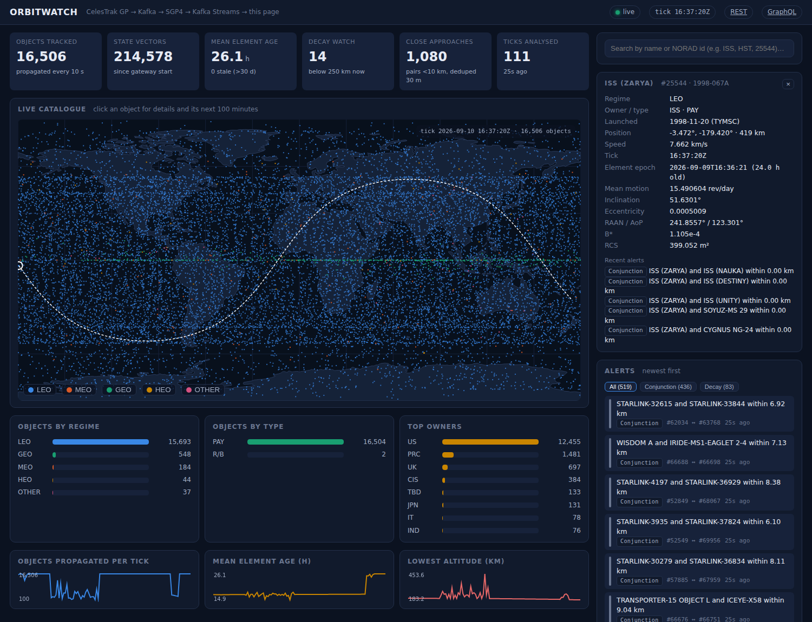
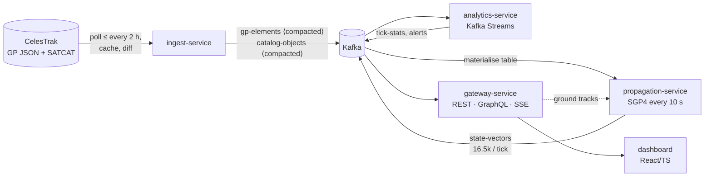

# OrbitWatch — SatelliteTelemetrySignals

An event-driven space domain awareness (SDA) demo: it pulls the public orbital catalogue from
CelesTrak (NORAD two-line/OMM element sets for ~16,500 active objects), turns it into a change
stream on Kafka, propagates every object's position with SGP4 every 10 seconds, runs streaming
analytics (per-tick statistics, close-approach screening, decay watch, stale elements, manoeuvre
candidates), and serves the result to a live dashboard over REST, GraphQL and Server-Sent Events.



Everything is Java 21 / Spring Boot 3.5 / Kafka (plus Kafka Streams), a TypeScript + React
dashboard, one Dockerfile for all services, a `docker compose` stack, and Terraform / Kubernetes
assets for Oracle Cloud Infrastructure. No orbital-mechanics library is used: the SGP4/SDP4
propagator is a self-contained port validated to the metre against the reference implementation.

## Quick start

```bash
./start.sh            # Windows: start.cmd    — builds, starts, waits for healthy, prints the URLs
./stop.sh             # Windows: stop.cmd     — add --wipe to delete the Kafka/cache volumes too
```

Options: `--observability` also starts Prometheus :9090 + Grafana :3000; `--rebuild` forces a clean
image build.

**Ports.** The start scripts check every published port first and move anything that is already in
use on the machine to the next free one, recording the result in `.env` — so the URLs they print
are the ones actually in use, and later runs keep the same ones. Delete `.env` to reset. Doing it
by hand instead, the overrides are `GATEWAY_PORT`, `INGEST_PORT`, `PROPAGATION_PORT`,
`ANALYTICS_PORT`, `KAFKA_UI_PORT`, `KAFKA_HOST_PORT`, `PROMETHEUS_PORT`, `GRAFANA_PORT`:

```bash
docker compose up --build            # ~5 min first time; then open http://localhost:8080
docker compose --profile observability up -d   # optional: Prometheus :9090 + Grafana :3000
docker compose down                  # add -v to wipe volumes
```

Fully offline (replays the committed CelesTrak snapshot instead of polling the live feed):

```bash
INGEST_GP_REPLAY_FILE=/data/snapshots/celestrak-active-2026-09-09.json \
INGEST_SATCAT_REPLAY_FILE=/data/snapshots/satcat-2026-09-09.csv \
docker compose up --build
```

Developer loop (Kafka in Docker, services as local JVMs, dashboard with hot reload):

```bash
docker compose up -d kafka kafka-ui
(cd dashboard && npm ci && npm run build)      # or `npm run dev` for hot reload on :5173
mvn -B verify                                  # 138 tests, no broker needed
scripts/run-local.sh --offline                 # logs in /tmp/orbitwatch
scripts/stop-local.sh
```

| Where | What |
|---|---|
| http://localhost:8080 | Dashboard (live map, KPIs, alerts, object detail with ground track) |
| http://localhost:8080/swagger-ui.html | REST API (OpenAPI) |
| http://localhost:8080/graphiql | GraphQL queries + WebSocket subscriptions |
| http://localhost:8080/api/stream/alerts | SSE stream (also `/stream/positions`, `/stream/stats`) |
| http://localhost:8390 | Kafka UI — topics, partitions, consumer lag |
| http://localhost:808{1,2,3}/api/* | ingest / propagation / analytics operator endpoints |
| `/actuator/prometheus` on every service | metrics |

**No reachable provider? It still runs.** If CelesTrak can't be reached (blocked network, offline,
corporate proxy) and there is no cache yet, ingest publishes the snapshot committed in `data/`,
logs `seeding from committed snapshot`, and reports `degraded` in
`:8081/actuator/health/readiness`. The whole demo works on 16,506 real objects; only the element
freshness is frozen, and the next scheduled run retries live. See
[ADR-0009](docs/adr/0009-degraded-beats-dead.md).

## How it works in one picture



[docs/diagrams/orbitwatch-system-design.drawio](docs/diagrams/orbitwatch-system-design.drawio) opens in
draw.io / diagrams.net (or the VS Code extension) with five pages: system overview, topic contracts,
the Kafka Streams topology, resilience, and build/deployment. It is generated by
`python3 docs/diagrams/generate.py`, so it can be regenerated when the system changes.

Read [docs/ARCHITECTURE.md](docs/ARCHITECTURE.md) for the full design: topic contracts, why each
service exists, the analytics rules, scaling and failure modes. [docs/INTERVIEW_TALKING_POINTS.md](docs/INTERVIEW_TALKING_POINTS.md)
is the walkthrough script. Decisions are recorded in [docs/adr](docs/adr).

## Repository layout

```
contracts/            versioned Kafka topic names + JSON event records shared by every service (the API contract)
astro-core/           pure-Java SGP4/SDP4, TEME→ECEF→geodetic, orbit regimes, spatial-grid conjunction screening
ingest-service/       CelesTrak client, cache, change detection → Kafka (Spring Boot, 8081)
propagation-service/  compacted-topic materialisation + tick loop → state vectors (Spring Boot, 8082)
analytics-service/    Kafka Streams topology → tick stats + alerts (Spring Boot, 8083)
gateway-service/      WebFlux REST + GraphQL + SSE, serves the dashboard (Spring Boot, 8080)
dashboard/            Vite + React + TypeScript; builds into gateway-service static resources
deploy/oci/terraform  one-VM OCI deployment (Ampere A1, cloud-init → docker compose)
deploy/k8s            kustomize base for OKE + overlay for OCI Streaming instead of self-hosted Kafka
deploy/observability  Prometheus scrape config + provisioned Grafana dashboard
data/                 CelesTrak snapshot (2026-09-09) for offline runs and reproducible tests
docs/                 architecture, ADRs, runbook, requirements/plan, interview notes
```

## Data source and etiquette

GP data comes from [CelesTrak](https://celestrak.org) (`gp.php?GROUP=active&FORMAT=json`) and
SATCAT from `celestrak.org/pub/satcat.csv`. CelesTrak asks that the same data not be fetched more
often than every two hours; the ingest service enforces that with an on-disk cache regardless of
its schedule, identifies itself with a User-Agent, and serves stale data if the site is down.
